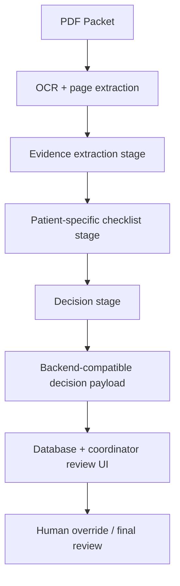

# Hybrid Architecture

## High-level flow

## Layer responsibilities

### 1. Extraction layer
Borrow from the backend:

- OCR each page
- gather patient facts
- track page numbers and evidence quotes
- detect missing or ambiguous documents

### 2. Reasoning layer
Borrow from yarong_dev:

- convert packet facts into checklist items
- identify relevant rules for this patient
- classify each item as met / pending / not_met / not_applicable
- write plain-language why + what-to-request notes

### 3. Decision layer
Generate a final recommendation and keep it explainable:

- approve
- deny
- maybe
- confidence
- reasons
- next steps

### 4. Storage layer
Map to backend schema:

- referral status
- ai_decision
- ai_decision_summary
- rule verdicts
- missing document requests
- coordinator override fields

## Key design decision

This hybrid model deliberately keeps:

- the backend as the operational system
- the yarong_dev-style steps as the interpretive engine

This avoids the biggest problem of maintaining two totally separate workflows.
